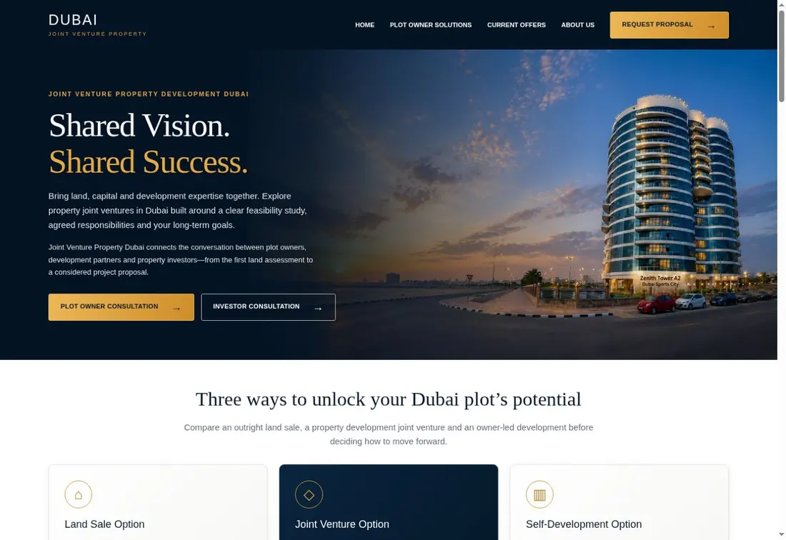

# Zenith Group Web Development Portfolio

**Dubai real estate websites · Multi-site delivery · Customer and partner journeys**

I developed websites for Zenith Group across property development, investment, and broker collaboration. The case studies and ChatGPT Sites gallery show how I turn business requirements into public websites with clear navigation and enquiry paths.

[Featured case studies](#featured-case-studies) · [ChatGPT Sites gallery](chatgpt-sites-portfolio/README.md) · [Google Search visibility](google-search-visibility/README.md) · [Program scope](website-index/README.md) · [Evidence and verification](evidence/README.md)

## Program at a glance

| Domains tracked | Categories | Marked completed | In progress | Not started |
| ---: | ---: | ---: | ---: | ---: |
| **316** | **26** | **275** | **1** | **40** |

The figures come from the Zenith website tracker. All five featured homepages responded over HTTPS on 24 November 2026.

## Featured case studies

| Website | What to inspect | Evidence |
| --- | --- | --- |
| **Dubai Joint Venture Property** | Plot-owner proposals and opportunity discovery | [Case study](case-studies/01-joint-venture/README.md) · [Live site](https://jointventurepropertydubai.com/) |
| **Dubai Property Development** | Multi-audience property platform | [Case study](case-studies/02-property-development/README.md) · [Live site](https://dubaipropertydevelopment.com/) |
| **Dubai Real Estate Co-Broker** | Broker onboarding and enquiry design | [Case study](case-studies/03-broker-collaboration/README.md) · [Live site](https://cobrokerrealestatedubai.com/) |
| **Invest in Dubai Property** | Investor education and offers navigation | [Case study](case-studies/04-dubai-property-investment/README.md) · [Live site](https://investindubaiproperty.net/) |
| **Dubai Pooled Investment** | Specialized campaign and cross-site navigation | [Case study](case-studies/05-pooled-investment/README.md) · [Live site](https://dubaipooledinvestment.com/) |

## Screenshots from the live websites

[View all four screenshots and their live pages](evidence/README.md#website-screenshots)

## ChatGPT Sites portfolio

The workspace lists **156 site projects**, including variants, and **135 active projects listed as public with a live URL**. The gallery shows 11 public websites with screenshots and live links, including five visitor walkthroughs.

[Explore the ChatGPT Sites gallery](chatgpt-sites-portfolio/README.md)

## Google Search visibility

[Zenith Developer](google-search-visibility/README.md#zenith-developer) recorded **1,061 clicks and 84,366 impressions** in Google Web Search from **22 August to 21 November 2026**. The evidence includes the workbook figures and a six-month dashboard screenshot.

The [website ranking catalog](google-search-visibility/website-ranking-catalog.md) covers **91 tracker entries across 77 unique domains**, with recorded positions for **70 domains**. The [Google Search visibility page](google-search-visibility/README.md) links to Search Console evidence for two websites.

## Start with the joint venture project

The joint venture site is the clearest example of translating business roles into website navigation. Follow the plot-owner route to see how the public site connects education, current opportunities, and a proposal action. [Read the joint venture case study](case-studies/01-joint-venture/README.md)

## How to read the evidence

Each case study names the audience, practical goal, visible design, and a short review route. The [website index](website-index/README.md) records tracker status. The [evidence page](evidence/README.md) records which public routes were checked and where evidence is still needed.

[Shah Hussain Bangash](https://github.com/shah-hussain-bangash)
