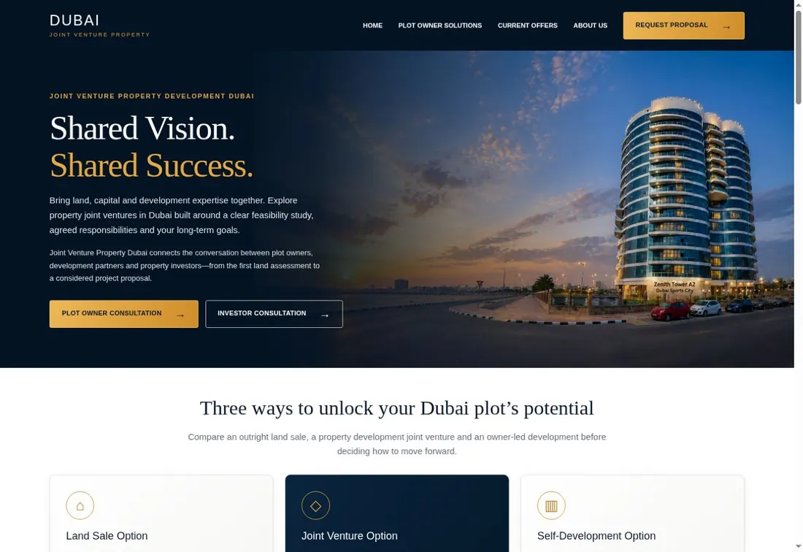
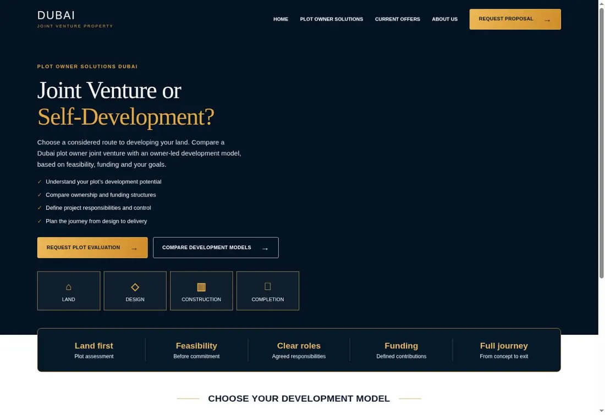

# Dubai Joint Venture Property

**Zenith Group website development · Plot-owner proposals and opportunity discovery**

[Open the live site](https://jointventurepropertydubai.com/) · [Evidence and verification](../../evidence/README.md)

## Website screenshots

The homepage gives plot owners and investors separate consultation paths.

The plot-owner page introduces joint venture and self-development before visitors choose how to proceed.

## Business context

| Audience | Website goal |
| --- | --- |
| Landowners considering development options and investors looking for current joint venture opportunities. | Give visitors a path suited to their role and explain how to request an initial discussion. |

## My contribution

I independently designed and built the Joint Venture Property Dubai website for Zenith Group. I created separate navigation paths for plot owners and investors, built the plot-owner guide and current-offers pages, and placed proposal and contact links where visitors could act on the information they had reviewed.

## What you can inspect

The homepage separates plot-owner, investor, and land-sale paths. It links to a plot-owner guide and a separate current-offers page, with proposal and contact links near the relevant content.

1. [Start at the homepage](https://jointventurepropertydubai.com/).
2. [Compare development options](https://jointventurepropertydubai.com/plot-owner-joint-venture-dubai/).
3. [Review current opportunities](https://jointventurepropertydubai.com/joint-venture-property-offers-dubai/).

**Review question:** Can a first-time plot owner identify the relevant development route and find the proposal action without visiting the investor offers?

## Delivery and evidence

The tracker marks this website **Completed** under **Joint Venture**. The public homepage was reachable on 24 November 2026. The [verification log](../../evidence/README.md) explains the scope of the check.

[Back to the portfolio](../../README.md) · [Website index](../../website-index/README.md)
