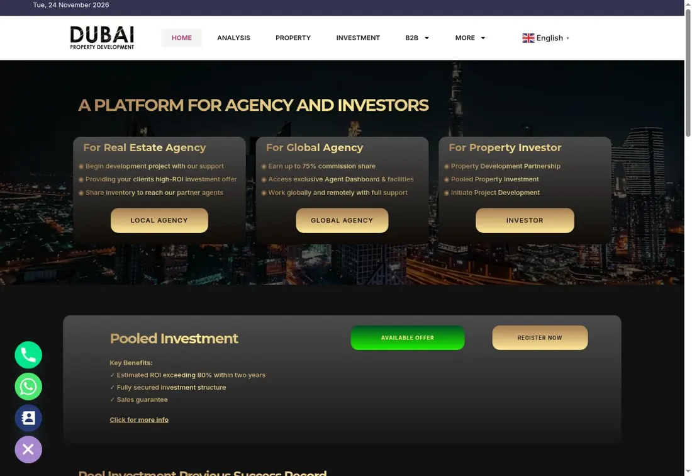
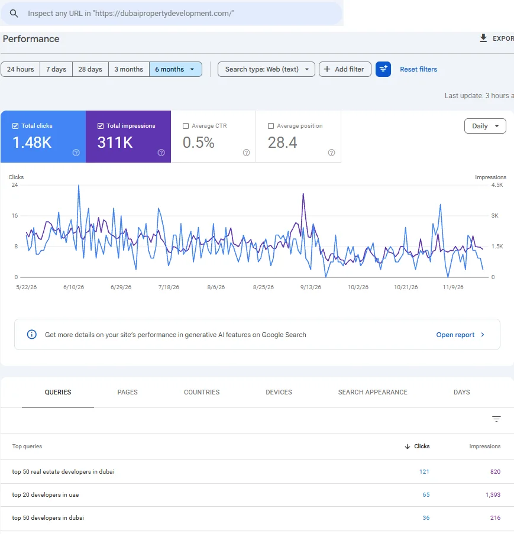

# Dubai Property Development

**Zenith Group website development · Multi-audience property platform**

[Open the live site](https://dubaipropertydevelopment.com/) · [Evidence and verification](../../evidence/README.md)

## Website screenshots

The homepage routes local agencies, global agencies, and property investors to distinct starting points.

## Business context

| Audience | Website goal |
| --- | --- |
| Local agencies, international agencies, and property investors. | Give each audience a distinct starting point on a website that also presents property, development services, and investment content. |

## My contribution

I developed this website as part of Zenith Group’s web development program. I use this site to demonstrate entry points by audience on a broader corporate platform. Keeping those links visible alongside service navigation helps visitors choose by role or by the information they need.

## What you can inspect

The homepage presents separate agency and investor entry points. The main menu also links to property, investment, development services, analysis, and company information. The local agency entry leads to a dedicated page.

1. [Start at the homepage](https://dubaipropertydevelopment.com/).
2. [Open the local agency page](https://dubaipropertydevelopment.com/real-estate-agency/).
3. [Open the portfolio homepage](https://dubaipropertydevelopment.com/).

**Review question:** Can an agency reach its dedicated page directly from the homepage, and can an investor identify a separate route?

## Google Search Console result

Dubai Property Development recorded **4,097 clicks and 874,403 impressions** in Google Web Search. The export dated **24 November 2026** covers **22 July 2025 to 21 November 2026**.

| Scope | Search evidence | Clicks | Impressions | CTR | Avg. position |
| --- | --- | ---: | ---: | ---: | ---: |
| Property | `https://dubaipropertydevelopment.com/` | 4,097 | 874,403 | 0.47% | ~20.7 |
| Country | United Arab Emirates | 2,352 | 423,979 | 0.55% | 32.31 |
| Query | “top 50 real estate developers in dubai” | 186 | 1,373 | 13.55% | 2.73 |
| Landing page | [Top 50 Property Developers in Dubai](https://dubaipropertydevelopment.com/top-50-property-developers-in-dubai/) | 854 | 68,740 | 1.24% | 19.08 |

The property totals use the daily Chart tab. Property CTR is calculated from total clicks and impressions. Property average position is estimated by weighting the rounded daily positions by impressions. The query figures cover all pages within the property, and the landing-page figures cover all queries for that page. A page-filtered query report would establish performance for the specific query and page together.

### Six-month screenshot

The six-month view captured on **24 November 2026** shows rounded property totals of **1.48K clicks**, **311K impressions**, **0.5% CTR**, and **28.4 average position**.

## Delivery and evidence

The tracker marks this website **Completed** under **Development Service**. The public homepage was reachable on 24 November 2026. The [verification log](../../evidence/README.md) explains the scope of the check.

[Back to the portfolio](../../README.md) · [Website index](../../website-index/README.md)
