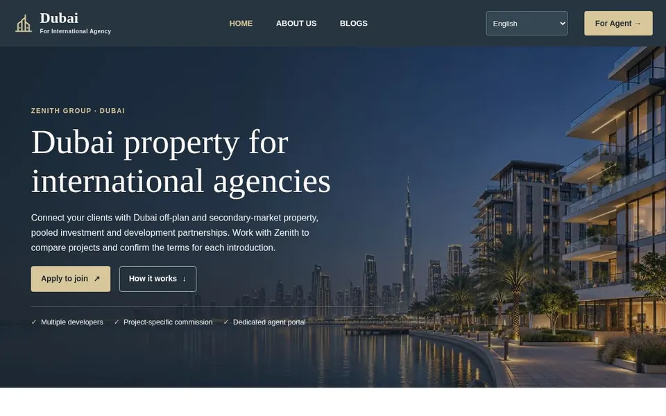
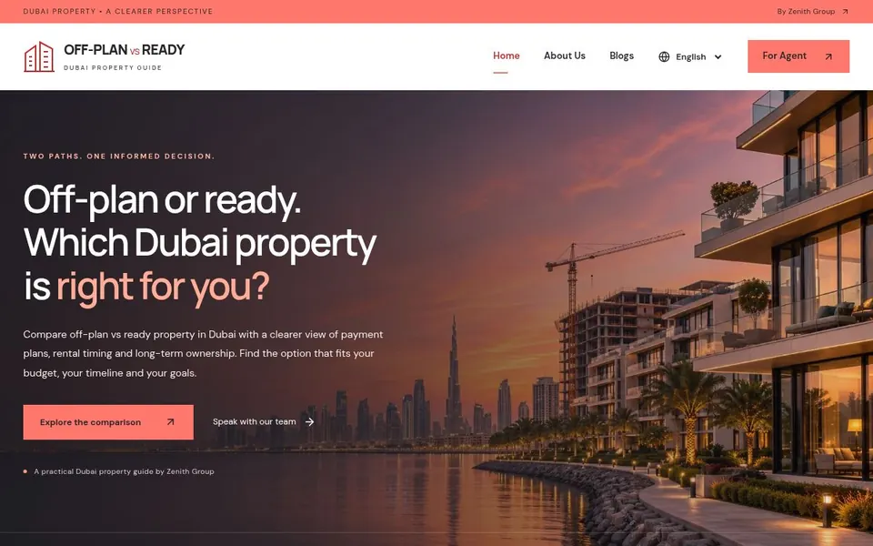

# ChatGPT Sites Portfolio

**AI-assisted website delivery for Zenith Group**

I used ChatGPT Sites to build Dubai real estate websites and site variants for buyers, investors, agencies, and brokers. These five examples show how I structured public content around distinct audiences, from agency onboarding to property comparison and enquiry design.

[Back to the Zenith portfolio](../README.md) · [Evidence and verification](../evidence/README.md)

## Workspace snapshot

| Owned projects | Active projects listed as public with a live URL | On `chatgpt.site` | On custom domains |
| ---: | ---: | ---: | ---: |
| **156** | **135** | **111** | **24** |

Workspace inventory on **24 November 2026**. The project count includes variants. The 316-domain Zenith tracker measures programme scope separately, and the two inventories may overlap.

## Featured builds

| Site | Workflow | Evidence |
| --- | --- | --- |
| **CoBroker Real Estate Dubai** | Broker onboarding | [Live site](https://cobroker-dubai-preserved-20261102.zenithdevelo-8780.chatgpt.site/) · [Screenshot](assets/cobroker-dubai.webp) |
| **Dubai Property for International Agencies** | International partner acquisition | [Live site](https://www.forinternationalagency.com/) · [Screenshot](assets/international-agency.webp) |
| **Off-Plan vs Ready Property in Dubai** | Buyer education | [Live site](https://offplan-vs-ready-dubai.zenithdevelo-8780.chatgpt.site/) · [Screenshot](assets/off-plan-vs-ready.webp) |
| **Investment in Dubai Real Estate** | Investor education and enquiries | [Live site](https://investment-dubai-real-estate-guide.zenithdevelo-8780.chatgpt.site/) · [Screenshot](assets/dubai-investment-guide.webp) |
| **Dubai Real Estate Investment Trends 2026** | Market-guide publishing | [Live site](https://dubai-real-estate-investment-trends-2026.zenithdevelo-8780.chatgpt.site/) · [Screenshot](assets/market-trends-2026.webp) |

### CoBroker Real Estate Dubai

Review how the homepage separates prospective agencies and independent agents, presents the collaboration steps, and gives returning agents a distinct portal link.

### Dubai Property for International Agencies

Follow the agency programme from its explanation of client introductions to the application action. This is the featured example on a custom domain.

### Off-Plan vs Ready Property in Dubai

Compare the two purchase routes, review the decision criteria, and find the next step for buyers with different priorities.

### Investment in Dubai Real Estate

Start with property types and investment considerations, then look at the routes to current offers and consultation.

### Dubai Real Estate Investment Trends 2026

Review how the site connects market information and investment opportunities to its process overview, FAQs, and consultation entry point.

## Verification

All five featured homepages returned HTTP 200 on **24 November 2026** without signing in. The walkthroughs describe visible pages and actions. Screenshots are workspace captures for the featured projects. Form delivery, authenticated workflows, search rankings, and conversion results are outside the scope of these checks.

[Back to the Zenith portfolio](../README.md) · [Evidence and verification](../evidence/README.md)
