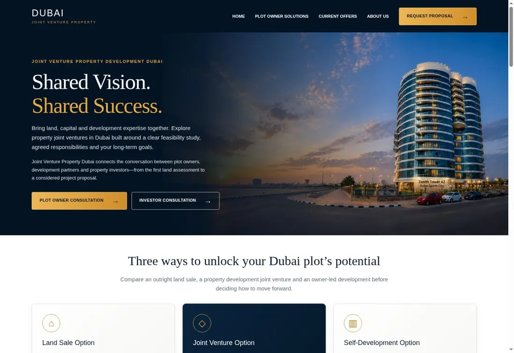
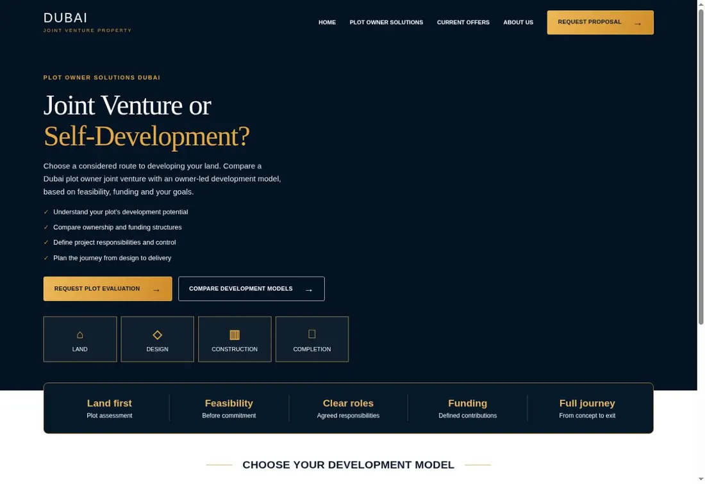
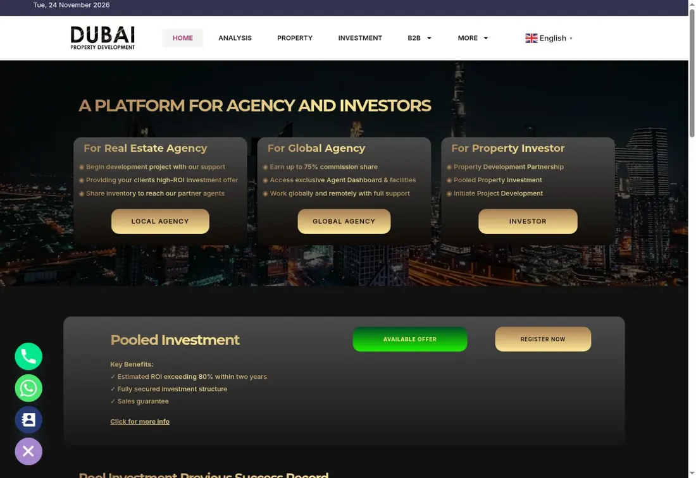
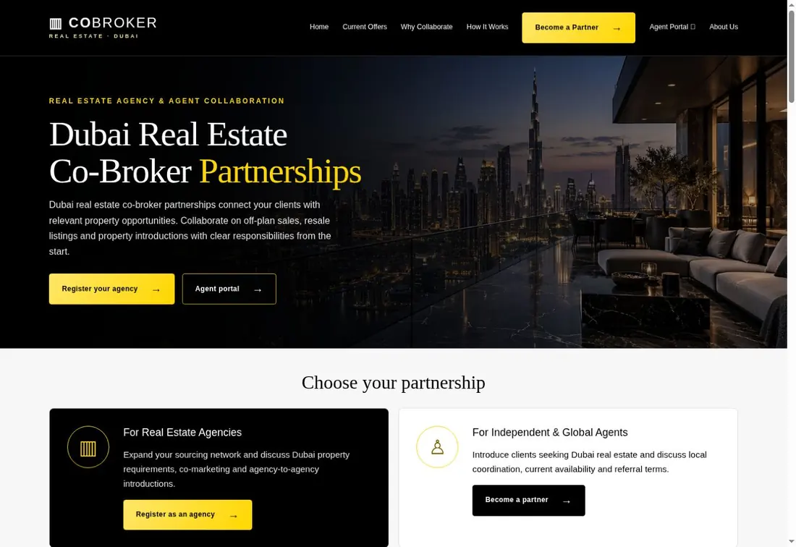
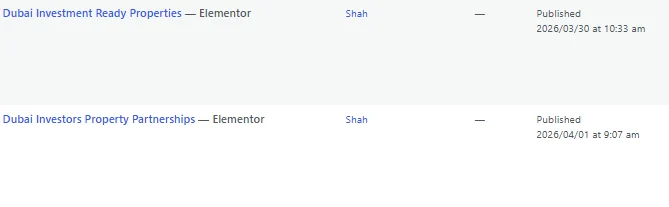
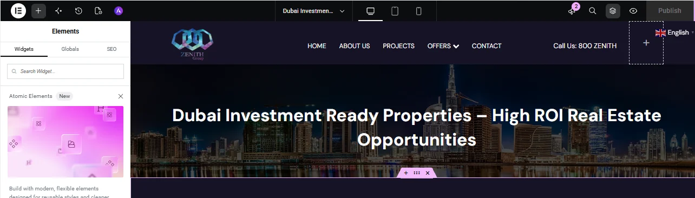

# Evidence and Verification

## Public route checks

Checked on **24 November 2026** using public HTTPS GET requests. Each featured homepage and each route listed below returned HTTP 200 after any redirects.

| Case study | Homepage | Additional routes checked |
| --- | --- | --- |
| [Dubai Joint Venture Property](../case-studies/01-joint-venture/README.md) | [Home](https://jointventurepropertydubai.com/) | [Compare development options](https://jointventurepropertydubai.com/plot-owner-joint-venture-dubai/) · [Review current opportunities](https://jointventurepropertydubai.com/joint-venture-property-offers-dubai/) |
| [Dubai Property Development](../case-studies/02-property-development/README.md) | [Home](https://dubaipropertydevelopment.com/) | [Open the local agency page](https://dubaipropertydevelopment.com/real-estate-agency/) |
| [Dubai Real Estate Co-Broker](../case-studies/03-broker-collaboration/README.md) | [Home](https://cobrokerrealestatedubai.com/) | [Browse Dubai property offers](https://cobrokerrealestatedubai.com/dubai-property-offers/) |
| [Invest in Dubai Property](../case-studies/04-dubai-property-investment/README.md) | [Home](https://investindubaiproperty.net/) | [Read the property investment guide](https://investindubaiproperty.net/dubai-property-investment/) · [Browse current offers](https://investindubaiproperty.net/current-offers/) |
| [Dubai Pooled Investment](../case-studies/05-pooled-investment/README.md) | [Home](https://dubaipooledinvestment.com/) | [Open the pooled-investment guide](https://dubaipooledinvestment.com/what-is-pool-investment/) · [Browse pooled-investment offers](https://dubaipooledinvestment.com/dubai-pooled-investment-offers/) |

## Website screenshots

Captured from the public websites on **24 November 2026**. Select an image to open the page it shows.

The homepage gives plot owners and investors separate consultation paths.

The plot-owner page introduces joint venture and self-development before visitors choose how to proceed.

The homepage routes local agencies, global agencies, and property investors to distinct starting points.

The homepage places agency registration and the returning-agent portal alongside the partner options.

The captures document the public interface and visible navigation. Enquiry delivery, implementation ownership, and business outcomes require separate records.

## Zenith Developer WordPress contribution

The WordPress Pages list for `zenithdeveloper.com` attributes these published Elementor pages to **Shah**.

| Published page | WordPress publication date |
| --- | --- |
| Dubai Investment Ready Properties | 30 March 2026 |
| Dubai Investors Property Partnerships | 1 April 2026 |

The Elementor editor shows the hero layout for **Dubai Investment Ready Properties**, including its page heading, skyline image, and desktop preview controls.

The excerpts show the WordPress author field, publication dates, and editor view. [Zenith Developer Search Console results](../google-search-visibility/README.md#zenith-developer) report property-wide search performance.

## Dubai Property Development WordPress contribution

The [Dubai Property Development case study](../case-studies/02-property-development/README.md#wordpress-contribution-evidence) shows three dated WordPress pages attributed to Shah, their Rank Math scores, and an Elementor layout excerpt for the investment guide.

## Property enquiry interface

The [Dubai Property Development case study](../case-studies/02-property-development/README.md#property-enquiry-interface) includes an Elementor excerpt of the Six Senses Residences enquiry section and WhatsApp contact button.

## ChatGPT Sites evidence

The [ChatGPT Sites gallery](../chatgpt-sites-portfolio/README.md) records the workspace project counts, screenshots, and 11 public homepage checks. Workspace counts and the Zenith domain tracker have different scopes and may overlap.

## Technical SEO portfolio

The [SEO Portfolio](../seo-portfolio/README.md#technical-seo-audits) summarizes the desktop audit tracker, its recorded checks, and the scope of the scores.

## Website ranking tracker

The [website ranking catalog](../google-search-visibility/website-ranking-catalog.md) preserves the 91 tracker entries and their recorded positions. The Search Console evidence below supports the two featured results.

## Google Search Console evidence

The [Dubai Property Development case study](../case-studies/02-property-development/README.md#google-search-console-result) includes the six-month Web Search report screenshot, site-wide metrics, and search-query figures.

The [Zenith Developer result](../google-search-visibility/README.md#zenith-developer) includes exact three-month click and impression totals, plus a six-month dashboard screenshot.

## How to interpret the results

- **Delivery status** comes from the website tracker.
- **Public availability** is a point-in-time check of the pages listed above.
- **Visitor journeys** describe visible navigation and actions. Enquiry submissions, authenticated portal access, and downstream lead delivery are outside this review.
- **Performance and business outcomes** require dated measurements. The portfolio currently records qualitative website evidence. The [Google Search visibility page](../google-search-visibility/README.md) summarizes tracker observations. The Dubai Property Development screenshot supports the site-wide Search Console figures shown in its case study. Conversions and performance scores require separate evidence.

[Back to the portfolio](../README.md)
