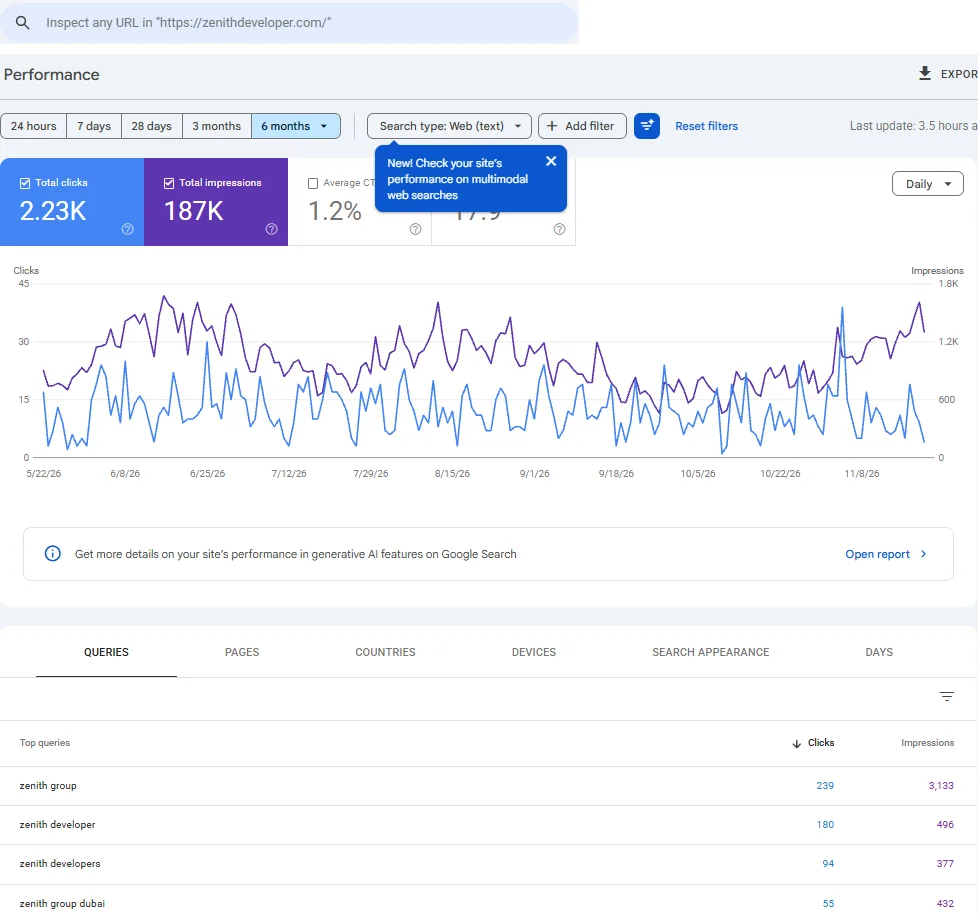

# Google Search Visibility

**Zenith Group web development portfolio**

I tracked Google Search visibility across Zenith's property and investment websites. This snapshot summarizes entries in the SEO tracker and shows how to validate the recorded positions against Google Search Console.

| Tracker metric | Count |
| --- | ---: |
| Website rows | 91 |
| Unique domains across those rows | 77 |
| Unique domains with a numeric position | 70 |

The source heading says 78 domains ranked. A count of the supplied rows yields 70 unique domains with a position. The count normalizes domain case and whitespace and combines repeated domains. The tracker does not include the search query, date range, country, or device for its position entries, so the values are historical tracker observations with unknown measurement scope.

## Search Console evidence for a featured site

[Dubai Property Development](../case-studies/02-property-development/README.md#google-search-console-result) recorded **4,097 clicks** and **874,403 impressions** in Google Web Search from **22 July 2025 to 21 November 2026**. The case study documents the property totals, UAE figures, query and landing-page metrics, and the six-month dashboard screenshot.

## Zenith Developer

[Zenith Developer](https://zenithdeveloper.com/) recorded **1,061 clicks and 84,366 impressions** in Google Web Search from **22 August to 21 November 2026**, with a **1.26% CTR**. The Search Console workbook was exported on **24 November 2026**.

| Scope | Clicks | Impressions | Average position |
| --- | ---: | ---: | ---: |
| Entire property | 1,061 | 84,366 | ~19.1 |
| United Arab Emirates | 773 | 62,103 | 19.86 |
| [Homepage](https://zenithdeveloper.com/) | 526 | 8,953 | 11.70 |
| Query “top 20 developers in uae” | 14 | 648 | 3.94 |

Property clicks and impressions are summed from the daily export. Property average position is estimated using impression-weighted daily values. The homepage row covers all queries for that URL. The featured query row covers the entire property.

### Six-month dashboard

The six-month Google Web Search view captured on **24 November 2026** shows approximately **2,230 clicks**, **187,000 impressions**, and **1.2% CTR**. This is a longer reporting window than the workbook above.

## Examples from the tracker

| Website | Recorded position | Public homepage check |
| --- | ---: | --- |
| [Property Investment JV](https://www.propertyinvestmentjv.com/) | 1 | HTTP 200 |
| [Dubai Property Investment Returns](https://www.propertyinvestmentreturnsdubai.com/) | 9 | HTTP 200 |
| [Invest in Development](https://www.investindevelopment.com/) | 12 and 14 | HTTP 200 |

The homepages were checked on **24 November 2026**. The two positions for Invest in Development come from separate tracker entries without dates. Homepage availability checks establish that the pages responded over HTTPS.

## Verify and improve

1. Start with Dubai Property Investment Returns. Open its verified property in [Google Search Console](https://search.google.com/search-console/) and check whether a relevant non-branded query has enough impressions to establish a baseline.
2. In Performance, select Web search, filter to the exact landing page and query, and use the same country and device filters for the last 28 days and the previous 28 days. Record clicks, impressions, CTR, and average position.
3. Use URL Inspection to confirm the Google-selected canonical and index status. If the query shows genuine demand, make the landing page more useful with a worked example of gross versus net rental yield that accounts for service charges and vacancy. Cite the inputs and label them as illustrative.
4. After the change, compare the same filters over an equivalent period. Report the figures and the date range alongside the page and query.

[Google Search Console position definitions](https://support.google.com/webmasters/answer/7042828) · [Back to the portfolio](../README.md)
